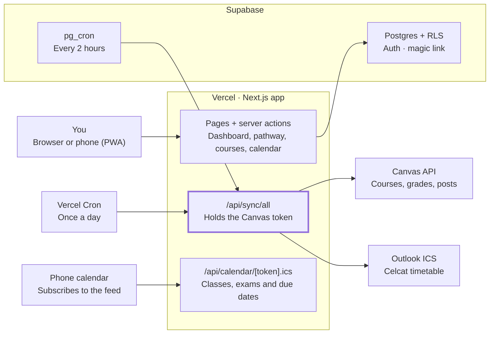

# College Hub — Project Spec

Oct 21, 2026 · Evan Khosh

## Overview

College Hub is a private, single-user web app that replaces the Notion Course Pathway and Canvas Hub with one site: a four-year degree planner and a live dashboard of Canvas classes, built on Next.js, Supabase and Vercel.

**Goals**

- A learning and portfolio project: real schema design, a third-party API integration, scheduled background jobs, auth and a polished UI.
- A tool used every day: open it in the morning and see today's classes, what's due and what changed, with no scrolling.
- Fix what Notion couldn't do: true full-width layouts, filters on computed values ("this week" from today's date), card sizing, and interactive planning.

**Non-goals for v1**

- Other users. It's built for one account; multi-user support can come later if it ever makes sense.
- Writing back to Canvas. The site reads Canvas and never submits, posts or edits anything there.
- Replacing the official degree audit. The pathway is a planning aid; the registrar's audit stays the source of truth.

**Where the data comes from today**

| Source | What it holds | Becomes |
| --- | --- | --- |
| Notion Course Pathway | 56 courses (171 SH, 53 of them transfer credit), 31 requirements, 32 swap options | One-off import into Postgres; the site is then the source of truth |
| Notion Canvas Hub | Assignments, announcements, class schedule, to-dos, synced by a weekday task | Replaced by the site's own Canvas sync; to-dos imported once |
| Canvas API (nulondon.instructure.com) | Courses, assignments, grades, announcements | Synced on a schedule with a personal access token |
| Outlook calendar (Celcat timetable) | Class times, rooms, exams | Synced from a published ICS link |

## Architecture

One Next.js app on Vercel serves the pages and runs the sync; Supabase holds the data and login; Canvas and the Outlook feed are only ever called from the server.



The highlighted box is the only code that holds the Canvas token. The Supabase service key stays server-side too.

The browser talks only to the Next.js app. Pages are React Server Components that read Postgres directly with your session, so row-level security applies to every query. The sync route is the only code that calls Canvas, and three things can start it: Vercel Cron, Supabase `pg_cron`, or you.

| Layer | Choice | Why |
| --- | --- | --- |
| Framework | Next.js (App Router) + TypeScript | Server Components keep secrets server-side; most common React framework in job postings |
| Styling | Tailwind CSS + shadcn/ui | Components you own and restyle, not a black-box library |
| Database + auth | Supabase (Postgres, Auth, `pg_cron`) | Real SQL, row-level security, free tier |
| Hosting | Vercel (Hobby) | Deploy on every push, preview URLs per branch |
| Validation | Zod | One schema checks Canvas responses and form input |
| Calendar parsing | `node-ical` | Reads the Outlook ICS feed |
| Tests | Vitest (units), Playwright (end-to-end) | Fast unit tests; one browser test per main flow |

## Security and secrets

The Canvas token can read every grade, submission and message in the account, so it lives only on the server and never reaches the browser, Git or a chat.

**Where each secret lives**

| Secret | Local | Production | Exposed to the browser? |
| --- | --- | --- | --- |
| `CANVAS_TOKEN` | `.env.local` | Vercel environment variable | Never |
| `CANVAS_BASE_URL` (`https://nulondon.instructure.com`) | `.env.local` | Vercel environment variable | No (not secret, but server-only) |
| `SUPABASE_SERVICE_ROLE_KEY` | `.env.local` | Vercel environment variable | Never; bypasses row-level security |
| `NEXT_PUBLIC_SUPABASE_URL`, `NEXT_PUBLIC_SUPABASE_ANON_KEY` | `.env.local` | Vercel environment variable | Yes, by design; row-level security protects the data |
| `CRON_SECRET` | `.env.local` | Vercel environment variable | Never; checked on every sync request |
| `OUTLOOK_ICS_URL` | `.env.local` | Vercel environment variable | Never; the link alone grants read access |
| `ALLOWED_EMAIL` | `.env.local` | Vercel environment variable | No |

**Rules**

- Only variables prefixed `NEXT_PUBLIC_` reach the browser. Nothing secret ever gets that prefix.
- Every module that touches Canvas or the service-role key starts with `import "server-only"`, so a mistaken import into a client component fails the build.
- `.env.local` is in `.gitignore` before the first commit. Commit a `.env.example` with the variable names and empty values.
- Turn on GitHub secret scanning and push protection for the repo.
- Row-level security is on for every table. Policies allow access only when `auth.uid()` matches the owner, and the sync job writes with the service-role key on the server.
- Login is a Supabase magic link. The sign-in action refuses any email other than `ALLOWED_EMAIL`, and public sign-ups are turned off in Supabase.
- `/api/sync/*` routes accept only `Authorization: Bearer <CRON_SECRET>` (Vercel Cron sends it automatically). The manual button is a server action that checks your session and runs the sync itself, so no route needs to trust a login cookie.
- Log sync results, never request headers or the token.

**Token rotation**

NU London caps Canvas tokens at 30 days. Rotate by generating a new token in Canvas, updating `CANVAS_TOKEN` in Vercel and `.env.local`, redeploying, then deleting the old token in Canvas. The sync records its last success, and a 401 from Canvas shows a "Canvas token expired" banner on the dashboard instead of failing silently.

## Data model

Twelve Postgres tables cover everything in the six Notion databases, plus sync history and the Phase 4 planner; Notion's formulas and rollups become SQL views instead of stored columns.

| Table | Holds | Filled by | Replaces in Notion |
| --- | --- | --- | --- |
| `terms` | Each semester, summer, co-op and the transfer-credit bucket, with dates and campus | Seed script | Courses → Term options |
| `courses` | Every course in the plan: code, title, SH, type, NUpath, status, Canvas course ID | Import, then edited in the app | Courses |
| `requirements` | Each degree requirement, its area and the courses that can fill it | Import | Requirements |
| `course_requirements` | Which course fills which requirement (many-to-many) | Import | Courses ↔ Fills requirement |
| `swap_options` | Alternative courses, their slot, quantum and AI relevance and the reasoning | Import | Swap options |
| `swap_replaces` | Which planned courses a swap could replace (many-to-many) | Import | Swap options → Replaces |
| `assignment_groups` | Canvas grading categories and their weights | Canvas sync | (new; needed for the grade calculator) |
| `assignments` | Canvas assignments, due dates, points, submission state, your own priority and notes | Canvas sync + you | Assignments |
| `announcements` | Canvas announcements with read and important flags | Canvas sync + you | Announcements |
| `class_sessions` | Every dated class, lab, seminar and exam, with room | Timetable sync | Class schedule |
| `todos` | Personal tasks, optionally tied to a course | You | To-dos |
| `sync_runs` | Start, finish, counts and errors for each sync | Sync jobs | (new) |

Phase 4 adds `course_prereqs` (course → required course, prereq or coreq) and `plans` + `plan_courses` for saved what-if plans.

**Design decisions**

- **Derived values are computed, never stored.** Notion's Year, Started, Done, Due in, Grade and requirement Progress become SQL views (`requirement_progress`, `assignments_view`) or TypeScript helpers.
- **Synced columns and your columns are separate.** The sync owns Canvas fields; you own `priority`, `est_hours`, `notes`, `progress`, `read`, `important`. The sync's upsert never lists your columns, so it can't overwrite them.
- **Status is two fields.** Canvas's `workflow_state` (unsubmitted, submitted, graded) is synced. Your `progress` (not started, in progress) is yours. The displayed status takes whichever is further along.
- **Times are `timestamptz` in UTC**, shown in the term's time zone: `Europe/London` for London terms, `America/New_York` from Fall 2027. Day names and "9:00 – 10:40" strings are formatted at display time, which removes the day-name sorting bug the Notion timetable had.
- **Every table has `owner_id uuid default auth.uid()`** and a row-level-security policy `owner_id = auth.uid()`, even with one user. It costs nothing and is the correct pattern to show.
- **Enums are Postgres enums** for closed sets (course type, requirement area, NUpath code, swap slot, relevance, session type, assignment type), so typos fail at the database.

**Core schema (first migration)**

```sql
create type course_type as enum ('cs_core','ai_concentration','physics_minor','major_support','general_elective','coop_program');
create type course_status as enum ('planned','in_progress','done');
create type nupath as enum ('ND','EI','IC','FQ','SI','AD','DD','ER','WF','WD','WI','EX','CE');
create type req_area as enum ('cs_overview','cs_fundamentals','cs_required','security_presentation','khoury_electives','supporting','writing','ai_concentration','physics_minor','universitywide');
create type term_kind as enum ('transfer','semester','summer','coop');

create table terms (
  id          smallint primary key,           -- sort order: 0 = transfer credit
  name        text not null unique,           -- 'Fall 2026 · London'
  kind        term_kind not null,
  campus      text,                           -- 'london' | 'boston' | null
  starts_on   date,
  ends_on     date,
  time_zone   text not null default 'America/New_York',
  owner_id    uuid not null default auth.uid()
);

create table courses (
  id               uuid primary key default gen_random_uuid(),
  code             text not null,              -- 'CS 2100'
  title            text not null,
  credits          numeric(3,1) not null,      -- SH
  type             course_type not null,
  term_id          smallint not null references terms(id),
  status           course_status not null default 'planned',
  nupath           nupath[] not null default '{}',
  notes            text,
  canvas_course_id bigint unique,
  owner_id         uuid not null default auth.uid(),
  unique (owner_id, code)
);

create table requirements (
  id        uuid primary key default gen_random_uuid(),
  name      text not null,
  area      req_area not null,
  options   text,                              -- 'CS 3100 + CS 3101'
  notes     text,
  owner_id  uuid not null default auth.uid()
);

create table course_requirements (
  course_id      uuid references courses(id) on delete cascade,
  requirement_id uuid references requirements(id) on delete cascade,
  primary key (course_id, requirement_id)
);

create table assignments (
  id                  uuid primary key default gen_random_uuid(),
  canvas_id           bigint not null unique,
  course_id           uuid not null references courses(id),
  assignment_group_id bigint,
  title               text not null,
  kind                text not null,         -- assignment | quiz | exam | discussion | lab | reading
  due_at              timestamptz,
  points_possible     numeric,
  html_url            text not null,
  workflow_state      text,                  -- synced: unsubmitted | submitted | graded
  score               numeric,               -- synced
  submitted_at        timestamptz,           -- synced
  deleted_in_canvas   boolean not null default false, -- synced
  synced_at           timestamptz not null default now(),
  -- yours: the sync never writes these
  progress            text not null default 'not_started',
  priority            text,
  est_hours           numeric,
  notes               text,
  owner_id            uuid not null default auth.uid()
);

-- swap_options, swap_replaces, assignment_groups, announcements,
-- class_sessions, todos and sync_runs follow the same pattern.

alter table courses enable row level security;
create policy "owner only" on courses for all
  using (owner_id = auth.uid()) with check (owner_id = auth.uid());
-- repeat enable + policy for every table
```

**Import check.** After importing from Notion, these queries must match the Notion totals: 56 rows in `courses`, `sum(credits)` = 171, transfer-credit `sum(credits)` = 53, 31 rows in `requirements` and 32 in `swap_options`. Write them as a test so the import can be re-run safely.

## Canvas and timetable sync

Sync runs three ways: a daily Vercel cron, a Supabase `pg_cron` job every two hours, and on demand when the dashboard opens with data older than 30 minutes. Vercel's free Hobby plan only allows cron jobs that run once a day, and fires them anywhere within the scheduled hour, so it can't be the only trigger ([Vercel](https://vercel.com/docs/cron-jobs/usage-and-pricing)).

**Triggers**

| Trigger | When | How it calls the sync |
| --- | --- | --- |
| Vercel Cron | Daily, `0 6 * * *` (Vercel uses UTC: 06:00 London in winter, 07:00 in summer) | GET `/api/sync/all` with `Bearer CRON_SECRET` |
| Supabase `pg_cron` + `pg_net` | Every 2 hours, 07:00–23:00 | Same route, same secret, stored in Supabase Vault |
| Dashboard load | Last successful sync older than 30 minutes | Server action starts the sync; the page shows cached data and refreshes when it finishes |
| "Sync now" button | Whenever you press it | Same server action |

**Canvas endpoints**

All requests send `Authorization: Bearer $CANVAS_TOKEN` to `$CANVAS_BASE_URL/api/v1`.

| Data | Endpoint | Notes |
| --- | --- | --- |
| Courses + current grade | `GET /courses?enrollment_state=active&include[]=total_scores` | Matched to `courses` by `canvas_course_id`; set the ID once per course |
| Grading groups + assignments + your submission | `GET /courses/:id/assignment_groups?include[]=assignments&include[]=submission` | One call per course gives weights, assignments and scores together |
| Announcements | `GET /announcements?context_codes[]=course_:id&start_date=…` | Last 60 days on each run |

**Rules for the Canvas client**

- Follow the `Link` header's `rel="next"` URL until there isn't one. Request `per_page=100`.
- Send one request at a time. Canvas throttles parallel requests harder, and a client that waits for each response is unlikely to be throttled ([Canvas throttling](https://developerdocs.instructure.com/services/canvas/basics/file.throttling)).
- On a 429, wait and retry up to three times with backoff. On a 401, stop, record "token expired" in `sync_runs`, and show the banner.
- Validate every response with a Zod schema before it touches the database, so a Canvas change fails loudly in one place.

**Upsert rules**

- Upsert by `canvas_id`. Re-running a sync is always safe.
- The upsert's column list includes only synced columns. `progress`, `priority`, `est_hours`, `notes`, `read` and `important` are never in it.
- `kind` (assignment, quiz, exam, lab, reading) is guessed on first insert from Canvas's `submission_types` and the title, then left alone so your correction sticks.
- An assignment that disappears from Canvas is marked `deleted_in_canvas = true`, not deleted, so your notes on it survive.
- Each run writes a `sync_runs` row with counts of inserted, updated and unchanged rows. The dashboard shows "Synced 12 min ago".

**Timetable (Outlook / Celcat)**

1. Publish your NU London Outlook calendar as an ICS link (Outlook on the web → Settings → Calendar → Shared calendars → Publish a calendar). If the university has disabled publishing, check whether Celcat itself offers a calendar subscription link.
2. Store the link as `OUTLOOK_ICS_URL`. Anyone with it can read your calendar, so treat it like a password.
3. Parse it with `node-ical` and keep every timed event: classes, optional workshops, talks, anything on the calendar. Events with a course code in their title are linked to `courses`; the rest are kept without a course and shown by their own title. All-day events are skipped. Celcat titles read `Discrete Structures CS1800; Lecture`: the code (with or without a space) ends the part before the semicolon, and the session type follows it.
4. Upsert into `class_sessions` by the event's `UID` plus `RECURRENCE-ID` (see the 2026-10-27 decision). A future session that vanishes from the feed is marked `cancelled = true`, not deleted. A new session is flagged `is_new` until you've seen it, matching what the Notion sync does today.

**Your own calendar feed**

Serve `/api/calendar/[token].ics` combining classes, exams and assignment due dates, so the phone's calendar app can subscribe. The URL token is a long random string stored in the database, separate from every other secret, and can be regenerated if it leaks.

## Pages and features

Seven pages cover everything: the dashboard answers "what do I do today", and the pathway answers "am I on track to graduate in May 2030".

| Route | Page | What's on it | Phase |
| --- | --- | --- | --- |
| `/` | Dashboard | Today's classes with rooms; due in the next 72 hours; new announcements; to-dos; countdown to the next exam; month calendar; "Synced 12 min ago". Fits one laptop screen with no scrolling; this week's detail sits below the fold. | 3 |
| `/courses/[code]` | Course page | Assignments by grading group, current grade, grade calculator, announcements, this course's timetable, your notes, links to Canvas | 3 |
| `/pathway` | Four-year plan | One column per term from Transfer credit to Spring 2030, course cards coloured by type, SH per term, co-op terms marked | 1, then 4 |
| `/pathway/requirements` | Requirements audit | Progress rings for CS core, AI concentration, Physics minor and NUpath; each requirement lists the courses filling it and their status | 1 |
| `/pathway/swaps` | Swap explorer | Swap options grouped by slot, sorted by the chosen focus's relevance, with the reasoning side by side | 1 |
| `/calendar` | Calendar | Month and week views merging classes, exams and due dates; link to subscribe on your phone | 3 |
| `/settings` | Settings | Sync status and history, token-expiry banner, course ↔ Canvas ID mapping, calendar feed link | 2 |

**Features by area**

- **Grade calculator.** Uses Canvas's assignment-group weights to show the current weighted grade and what's needed on remaining work to reach a target grade. Pure TypeScript functions with unit tests, since the maths is easy to get subtly wrong.
- **Announcements.** Unread count on the dashboard; mark read or important; full text on the course page.
- **Drag-and-drop planning (Phase 4).** Move a course card to another term. The move is checked against `course_prereqs`, co-op terms and a per-term SH limit, and any conflict shows inline before you save.
- **Prerequisite graph (Phase 4).** Courses as nodes, prerequisites as arrows, with the PHYS 4115 → PHYS 5352 quantum chain highlighted. Laid out by term, one column each (see the 2026-10-27 decision).
- **Quantum / AI toggle (Phase 4).** Re-sorts swap options by quantum or AI relevance (see the 2026-10-27 decision). The quantum chain is already highlighted in the prerequisite graph.
- **What-if plans (Phase 4).** Save a copy of the plan, change it freely, and compare two plans side by side. The real plan is untouched until you make one the active plan.
- **Polish.** Installable on your phone (PWA manifest and icons), global search (⌘K) across courses, assignments and announcements, and an optional light/dark toggle (dark mode already follows the system; see Visual design).

## Visual design

Apple-style restraint on the warm Canvas Hub palette. Tokens live in `app/globals.css` as `light-dark()` pairs, and dark mode follows the system. The 2026-10-26 entries in `docs/decisions.md` explain the reasoning; this section is the rulebook.

**Colour roles.** Every colour has one job. Never use a role's colour for another role, and never use colour alone: pair it with an icon shape, a label or text.

| Role | Tokens | Used for | Never used for |
| --- | --- | --- | --- |
| Tint | `primary` (wine light, Golden Batter dark), `ring` | Buttons, links, focus rings, the app icon. At most one filled primary button per view; the rest are outline, secondary or ghost | Decoration, headings, eyebrows, status |
| Label | `accent` (Golden Batter tint) | Neutral labels: co-op term, swap relevance (graded by rank) | Status or warnings |
| Status | `status-planned`, `status-in-progress`, `status-done`, `status-due-soon`, `status-overdue` | Course and assignment state | Categories |
| Category | `course-*` (six course types) | The bar and legend dot that mark a course's type (cards stay plain `card`) | Status |
| Error | `destructive` (= `status-overdue`) | Form errors, destructive actions, overdue work | — |

**Status palette.** Shared by courses (Phase 1) and assignments (Phases 2–3), so the same hue always means the same thing.

| Status | Hue | Courses | Assignments |
| --- | --- | --- | --- |
| Planned / not started | Neutral grey | `planned` (empty circle) | Not started: outline-only neutral pill |
| In progress | Blue (250) | `in_progress` (dotted circle), current term outline | Your `progress = in progress` |
| Done | Green (145) | `done` (check) | Submitted or graded: filled green pill |
| Due soon | Amber (70) | — | Due within 72 hours and not submitted |
| Overdue | Red (27) | — | Past due and not submitted |
| Missed | Neutral grey | — | Over 30 days past due and not submitted: outline pill with a circle-minus icon |

Due soon, overdue and missed are derived at display time from `due_at` and the displayed status, never stored. Each status colour passes 4.5:1 on cards in both themes, so it can colour text as well as icons and arcs.

**Course types** use hues no status uses (rose 350 CS core, teal 195 AI concentration, violet 300 Physics minor, olive 90 Major support (moss 122 in light mode, where olive sat too close to due-soon amber), neutral grey General elective, dark stone Co-op / program). Each chromatic type is at least 10 ΔE (OKLab ×100) from every status colour, the tint and the other types; the two neutral types share planned's grey on purpose, since planned is the absence of a status hue. Every token stays inside sRGB, so the numbers hold on any screen. `lib/colour/tokens.test.ts` checks all of this, and the contrast rules below, against `globals.css`; a new or changed colour must pass it.

**Text levels.** `foreground` for primary text; `muted-foreground` for secondary text (titles under codes, descriptions, captions); `tertiary-foreground` for metadata (credits, counts) on cards or the page background only. On tinted fills, use `muted-foreground`, since tertiary drops below 4.5:1 there.

**Type sizes.** Content people read is at least `text-footnote` (13px): excerpts, details, titles under codes. `text-xs` (12px) is for metadata only (counts, times, pills, badges), with one exception: the calendar's week and month grids, where space is set by time and date. Uppercase is kept for page eyebrows; in-card headings and labels are sentence case.

**Fills.** Grey surfaces are translucent tints of the foreground, never solid greys: `fill` for tracks and pressed or hovered controls, `fill-secondary` for control backgrounds (nav track, close button), `fill-tertiary` for grouping backgrounds (term columns, reason panels). `secondary` and `muted` are aliases of these for shadcn components.

**Wayfinding.** On the pathway, finished terms recede (no tint, flat cards, muted heading), and the current term gets the in-progress outline and a "Current term" label. Without term dates, the phase comes from course status (`summarizeTerms`).

**Accessibility.** Text 4.5:1 and meaningful graphics 3:1 in both themes. `prefers-contrast: more` darkens secondary text, strengthens fills and hairlines, and thickens colour marks. `prefers-reduced-transparency` makes the header solid. `prefers-reduced-motion` removes movement but keeps feedback.

## Phases

Five phases, each ending with something you can use; a phase is done when its last box is ticked, not when the code compiles.

### Phase 0: Setup

- [x] Revoke the token pasted into chat on 21 Oct and generate a fresh one
- [x] Create the GitHub repo (private for now), with secret scanning and push protection on (GitHub's built-in scanning is not available for private repos on this plan, so a `gitleaks` pre-commit hook in `.githooks/` does this job instead)
- [x] `npx create-next-app@latest` with TypeScript, App Router, Tailwind, ESLint
- [x] Add shadcn/ui and pick the warm palette as CSS variables
- [x] Add `.env.local` to `.gitignore`, commit `.env.example`, then fill `.env.local`
- [x] Create the Supabase project; install the Supabase CLI and run it locally with `supabase start`
- [x] Magic-link login restricted to `ALLOWED_EMAIL`; public sign-ups off
- [x] Connect the repo to Vercel and add the environment variables there
- [x] Copy `CLAUDE.md` into the repo root

**Done when:** the deployed site shows a "Hello Evan" page only after signing in, and `gitleaks git` finds no secrets anywhere in the history.

### Phase 1: Data model and pathway

- [x] First migration: enums, `terms`, `courses`, `requirements`, `course_requirements`, `swap_options`, `swap_replaces`, RLS on all
- [x] Seed `terms` with time zones (dates deferred; see the 2026-10-25 decision)
- [x] Import script (`scripts/import-notion.ts`) reading the Notion API or a CSV export
- [x] Import test: 56 courses, 171 SH total, 53 SH transfer credit, 31 requirements, 32 swaps
- [x] `requirement_progress` view
- [x] `/pathway`, `/pathway/requirements` and `/pathway/swaps` pages, read-only
- [x] Edit a course's status and term from the pathway page

**Done when:** you'd rather open `/pathway` than the Notion Course Pathway.

### Phase 2: Canvas sync

- [x] Canvas client with pagination, retries, 401 handling and Zod validation
- [x] Map each Fall 2026 course to its `canvas_course_id`
- [x] Migrations: `assignment_groups`, `assignments`, `announcements`, `sync_runs`
- [x] `/api/sync/all` route protected by `CRON_SECRET`
- [x] Vercel Cron (daily) and Supabase `pg_cron` (every 2 hours)
- [x] Unit tests for the upsert proving your own columns survive a re-sync
- [x] `/settings` with sync history and the token-expired banner

**Done when:** a new Canvas assignment appears on the site within two hours without you doing anything.

### Phase 3: Dashboard, course pages and calendar

- [x] Timetable sync from the ICS link into `class_sessions` (every timed Outlook event; see the 2026-10-27 decisions)
- [x] `todos` table; import the Notion to-dos once (one row, re-entered by hand instead; see the 2026-10-27 decision)
- [x] Dashboard at `/`, no scrolling on a laptop
- [x] Course pages with the grade calculator and its unit tests
- [x] `/calendar` month and week views
- [x] Personal ICS feed, subscribed on your phone

**Done when:** you stop opening the Notion Canvas Hub, and the Notion sync task can be switched off.

### Phase 4: Planning tools and polish

- [x] `course_prereqs` table, entered by hand from the course catalogue (AND of OR-groups, plus advisory `recommended` links; see the 2026-10-27 decisions)
- [x] Drag-and-drop pathway with live checks
- [x] Prerequisite graph (laid out by term, without React Flow; see the 2026-10-27 decision)
- [x] Quantum / AI toggle (re-sorts swap options only; see the 2026-10-27 decision)
- [x] Saved what-if plans and side-by-side comparison (moves and swaps; see the 2026-10-27 decision)
- [x] PWA, ⌘K search, light/dark toggle (installable without a service worker; see the 2026-10-29 decision)
- [x] Playwright end-to-end tests for the main flows (separate server and invented user; see the 2026-10-29 decision)

**Done when:** you've used it to plan Spring 2027 registration.

## Portfolio notes

The repo is what co-op reviewers will see, so make the engineering decisions visible: a demo mode with fake data, a README that explains the trade-offs, and tests on the parts that are easy to get wrong.

- **Demo mode.** A `DEMO=true` deployment seeded with an invented student, so the public link never shows your grades. Make the repo public only once demo mode works. *(2026-10-29: the invented student exists as `data/example`, and any school can be loaded from a data folder; see the decision log. A public demo deployment using it is still to do.)*
- **README.** One screenshot of the dashboard and one of the pathway, the stack, an architecture diagram, and a short "Decisions" section: why Supabase over Notion as the backend, why the sync never overwrites your fields, how the Canvas token stays server-side, and how the sync works around the Hobby cron limit.
- **Decision log.** Keep `docs/decisions.md` with one dated entry per real decision. It doubles as interview material.
- **Tests worth showing.** Grade calculator, sync upsert (your columns survive), import totals, requirement progress, and one Playwright flow.
- **Commits.** Small, one change each, with clear messages. A readable history is part of the portfolio.
- **Write-up.** When Phase 3 is done, write a short post on what broke and what you'd change.

## Sources

- [Vercel: Usage and pricing for cron jobs](https://vercel.com/docs/cron-jobs/usage-and-pricing)
- [Canvas LMS API: Throttling](https://developerdocs.instructure.com/services/canvas/basics/file.throttling)
